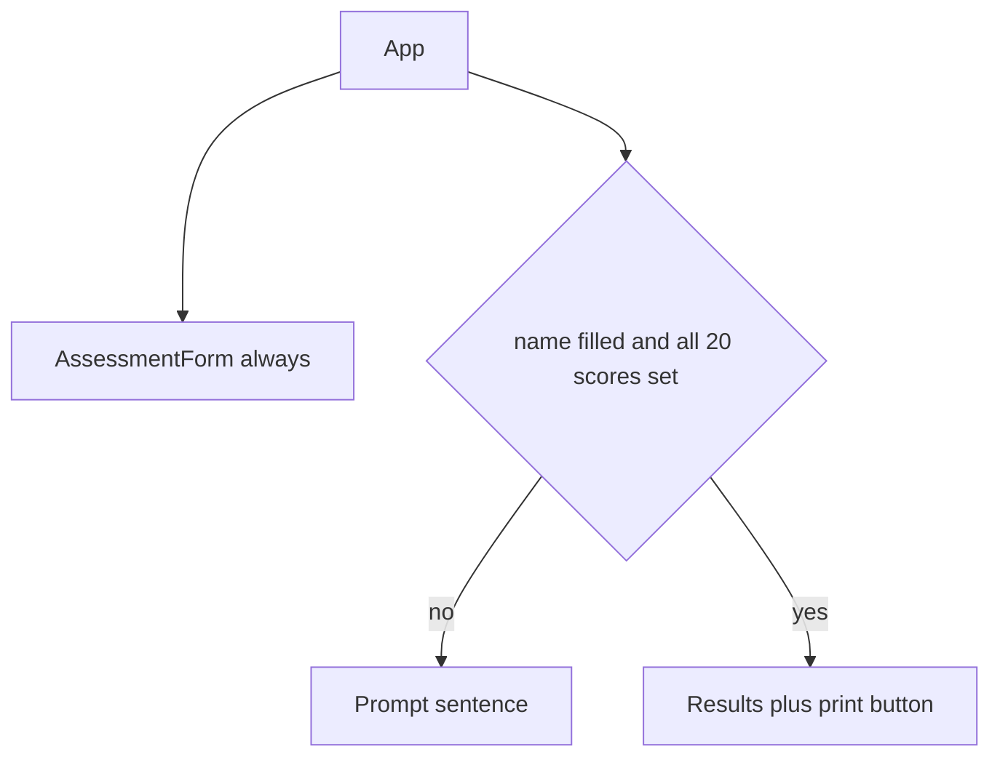

# Delivery Health Check — design (v1)

Version 1 is one page. There is no router, no state library, and no new npm package. React state is a single `useState` in [src/App.tsx](../src/App.tsx). Scoring and `localStorage` stay in pure functions under [src/lib](../src/lib). Statement text and suggested actions are copied exactly from [docs/question-bank.md](question-bank.md), including the apostrophe character already in that file.

The current Vite starter (counter, logos, [src/App.css](../src/App.css)) is replaced when implementation starts. This document is the design only. It does not add application code.

## Screens

There is one screen, not two routes. The form is always on the page. Results are a second region that React either mounts or does not mount.

Screen order, top to bottom:

- Heading `Delivery Health Check` (the only `h1`).
- A print-only block (hidden on screen): the engagement name as typed, the label `Client` plus the client text (empty when the client is empty), and the assessment date as `YYYY-MM-DD`.
- The form (hidden when printing): engagement name, client, assessment date, the scale once, then the five areas and 20 statements, then `Start new assessment`.
- Either the sentence `Enter the engagement name and answer all 20 statements to see results.`, or the results region.

Results order, only while they are shown:

- `Print / Save as PDF` (hidden when printing).
- Overall line: label `Overall`, score to one decimal (`4.0`, `5.0`), RAG word `Red`, `Amber`, or `Green`.
- Area table.
- Radar chart.
- `Focus first:` plus the area name.
- Suggested actions for all five areas.

On-screen results do not repeat the name, client, or date. Those stay in the fields. Print reads the print-only block plus the results region, so those three values are not printed twice.



A name is filled when it contains at least one character other than a normal space (U+0020). A tab, a non-breaking space, an emoji, or a letter counts. Spaces around a real character are kept. The client may be empty.

## Components

- [src/App.tsx](../src/App.tsx) holds the assessment, loads and saves it, runs confirm and print, and chooses the prompt or `Results`.
- [src/components/AssessmentForm.tsx](../src/components/AssessmentForm.tsx) is the three fields, the scale, and the five areas. It does not score and it does not touch `localStorage`.
- [src/components/Results.tsx](../src/components/Results.tsx) is the overall line, the table, the chart, the focus line, and the actions.
- [src/components/AreaChart.tsx](../src/components/AreaChart.tsx) is the Recharts radar chart.

`AssessmentForm` takes the assessment plus four callbacks: name, client, date, and score (`index`, `1`–`5`). Each statement is a `fieldset` whose `legend` is the statement text, with five radios named for that statement only. Labels are `1` through `5`. Clicking the selected radio leaves it selected. There is no clear control.

The scale is one list, above the areas, not repeated: `1 Strongly disagree`, `2 Disagree`, `3 Partly`, `4 Agree`, `5 Strongly agree`.

Area names are `h2`. Action area names are `h3`. The page has one `h1`.

`Results` takes the scored result. Green areas render `No action needed`. Red or Amber areas render that area’s two sentences from the question bank, in that order.

`AreaChart` data is the five area names and their one-decimal scores. The wrapper has accessible name `Area scores` (`role="img"` and `aria-label="Area scores"`). `PolarAngleAxis` prints `Scope`, `Schedule`, `Team`, `Quality`, and `Stakeholders` as SVG text. `PolarRadiusAxis` uses domain `0` to `5`.

## Files

- [src/main.tsx](../src/main.tsx) — unchanged role: render `App`.
- [src/App.tsx](../src/App.tsx) and [src/App.test.tsx](../src/App.test.tsx)
- [src/index.css](../src/index.css) — screen layout, RAG colours, print rules. Drop the starter dark-theme layout.
- [src/data/questionBank.ts](../src/data/questionBank.ts) — five areas in order, four statements each, two actions each, and the five scale labels.
- [src/lib/types.ts](../src/lib/types.ts) — shared types only.
- [src/lib/scoring.ts](../src/lib/scoring.ts) and [src/lib/scoring.test.ts](../src/lib/scoring.test.ts)
- [src/lib/storage.ts](../src/lib/storage.ts) and [src/lib/storage.test.ts](../src/lib/storage.test.ts)
- [src/components/AssessmentForm.tsx](../src/components/AssessmentForm.tsx) and its test.
- [src/components/Results.tsx](../src/components/Results.tsx) and its test.
- [src/components/AreaChart.tsx](../src/components/AreaChart.tsx) — covered by the Results test for the accessible name and the five labels.

Remove [src/lib/example.test.ts](../src/lib/example.test.ts) and [src/App.css](../src/App.css) when implementation starts.

## Types

```ts
type Score = 1 | 2 | 3 | 4 | 5
type Rag = 'Red' | 'Amber' | 'Green'
type AreaName = 'Scope' | 'Schedule' | 'Team' | 'Quality' | 'Stakeholders'

type Assessment = {
  engagementName: string
  client: string
  assessmentDate: string // YYYY-MM-DD
  scores: Array<Score | null> // length 20, statement order
}

type AreaScore = {
  area: AreaName
  tenths: number // 43 means 4.3
  text: string   // "4.3"
  rag: Rag
}

type AssessmentResult = {
  areas: [AreaScore, AreaScore, AreaScore, AreaScore, AreaScore]
  overallTenths: number
  overallText: string
  overallRag: Rag
  focusFirst: AreaName
}
```

Scores are stored as integers of tenths so rounding never uses a binary float. Display text is built from that integer (`43` becomes `4.3`, `40` becomes `4.0`). The chart may pass `tenths / 10` to Recharts; the words on the page come from `text`.

## Pure functions

Scoring in [src/lib/scoring.ts](../src/lib/scoring.ts). All inputs are positive. Division is integer arithmetic: round half up of `n / d` is `Math.floor((2 * n + d) / (2 * d))`.

- `areaTenths(answers: readonly [Score, Score, Score, Score]): number` — `sum * 10 / 4`, half up, so `4.25` is `43` and `3.75` is `38`.
- `formatTenths(tenths: number): string` — one decimal place, no `toFixed`.
- `ragForTenths(tenths: number): Rag` — Green at `40` and above, Amber from `30` to `39`, Red below `30`.
- `overallTenths(areaTenths: readonly [number, number, number, number, number]): number` — sum of the five rounded area tenths, divide by `5`, half up. `212` (the value `21.2`) becomes `42` (`4.2`). `214` becomes `43` (`4.3`).
- `overallRag(overallTenths: number, areaRags: readonly Rag[]): Rag` — bands above; if that band is Green and any area is Red, return Amber. Amber areas do not change Green. A Red area does not change Amber or Red.
- `focusFirst(areas: readonly { area: AreaName; tenths: number }[]): AreaName` — lowest tenths; tie breaks Scope, Schedule, Team, Quality, Stakeholders.
- `scoreAssessment(scores: readonly Score[]): AssessmentResult` — four answers per area in question-bank order. Caller only uses this when all 20 scores are set.

Saving in [src/lib/storage.ts](../src/lib/storage.ts). The key is `dhc-assessment`.

- `todayIsoDate(now: Date): string` — local calendar `YYYY-MM-DD` from `getFullYear`, `getMonth`, and `getDate`. Not `toISOString` (that is UTC).
- `isRealIsoDate(value: string): boolean` — exact `YYYY-MM-DD` and a real calendar day. `2026-02-31` and `2026-2-01` fail.
- `emptyAssessment(today: string): Assessment` — empty name, empty client, that date, twenty `null`s.
- `isEngagementNameFilled(name: string): boolean` — true when some character is not U+0020.
- `canShowResults(assessment: Assessment): boolean` — filled name and every score is `1`–`5`.
- `parseAssessment(raw: string): Assessment | null` — `null` unless the value is a JSON object, both name fields are strings, the date is real, and `scores` is 20 items each `null` or an integer `1`–`5`. A numeric string such as `"4"` is rejected. Extra properties are ignored. Nothing is kept from a rejected value.
- `loadAssessment(storage): Assessment | null` — `getItem`. Missing key, a throw, or a rejected value returns `null`. App then uses `emptyAssessment(today)`.
- `saveAssessment(storage, assessment): void` — `JSON.stringify` the four fields and `setItem`. A throw is swallowed.
- `clearAssessment(storage): void` — `removeItem`. A throw is swallowed.

`storage` is `Pick<Storage, 'getItem' | 'setItem' | 'removeItem'>` so tests can pass a fake.

## How App switches form and results

`App` does not navigate. On first render it reads storage once:

`loadAssessment(localStorage) ?? emptyAssessment(todayIsoDate(new Date()))`

That initial read does not write the key. Later edits go through one updater: set state, then `saveAssessment`. If save throws, the new state stays on screen.

The form is always rendered. During render, `canShowResults(assessment)` chooses the child:

- false: the prompt paragraph, no `Results`, no print button.
- true: `scoreAssessment` on the twenty scores, then `Results` and the print button.

Changing a score, the client, the date, or a still-filled name updates state and the derived result in the same render. Clearing the name back to empty or only normal spaces unmounts `Results`.

The date input is controlled. If its change value is `""`, App sets today’s local date at that moment, so the value is never empty. The user can pick any other real date.

`Start new assessment` calls `window.confirm` with `Start a new assessment? This clears the current answers.` Cancel or dismiss does nothing. OK calls `clearAssessment`, then sets empty state with today’s date at the moment of OK. The key stays absent until the next edit.

## Print CSS

Classes in [src/index.css](../src/index.css):

- `.print-only` is `display: none` on screen.
- `.no-print` marks the form, the prompt, and both buttons.

```css
@media print {
  .no-print { display: none; }
  .print-only { display: block; }
}
```

`@page { size: A4; }` leaves the browser’s default margins. Compact type and a short chart height keep the check case on one page: Chrome, A4, default margins, a one-line name, a one-line client, and all five areas Red or Amber. A longer name or client still prints in full and may wrap. `break-inside: avoid` on the table and the chart.

RAG colour is a word plus a class: `.rag-red`, `.rag-amber`, `.rag-green`. The word is what tests read. Colour is checked by eye.

Print is `window.print()` on the button. The app does not build a PDF.

## Tests

Every acceptance criterion that is not marked `(manual)` gets a test whose name starts `DHC-<n> AC<k>:`. Tests sit next to the file they exercise. Component tests use Testing Library and look at text, roles, and labels.

- [src/lib/scoring.test.ts](../src/lib/scoring.test.ts) — DHC-2 AC1, AC2, AC3, AC4, AC5, using the worked rows in [docs/requirements.md](requirements.md).
- [src/lib/storage.test.ts](../src/lib/storage.test.ts) — DHC-4 AC2 (JSON shape, `null` for unanswered, write on save) and DHC-4 AC3 (missing key, thrown read, rejected values listed in the story, no partial apply, thrown save does not throw onward).
- [src/components/AssessmentForm.test.tsx](../src/components/AssessmentForm.test.tsx) — DHC-1 AC2, AC3, AC4, AC5, AC6. Date cases freeze `Date` with Vitest fake timers. Tests read the date input’s value.
- [src/components/Results.test.tsx](../src/components/Results.test.tsx) — DHC-3 AC2, AC3, AC5, AC7, and DHC-5 AC1, AC2. AC5 looks for accessible name `Area scores` and the five area names inside the chart.
- [src/App.test.tsx](../src/App.test.tsx) — DHC-1 AC1 (only `h1`). DHC-3 AC1, AC8, AC9 (show, hide, live score update, client and date edits keep results). DHC-4 AC1, AC2 (change then remount `App` and see the saved values), AC4, AC5. DHC-5 AC3 (score change updates action text). DHC-6 AC1, AC2 (`window.print` replaced in the test).

No automated test for the manual criteria: DHC-3 AC4 (colour), DHC-3 AC6 (radar shape and 0–5 scale), DHC-6 AC3 (print preview content and one page), DHC-6 AC4 (print preview hides the fields, scale, choices, prompt, and both buttons). Those are checked in the browser during implementation.

DHC-4 AC2 and AC3 are named in both the storage file and `App.test.tsx`: the lib tests lock the JSON rules, and the App tests lock what the page shows after a reload.
